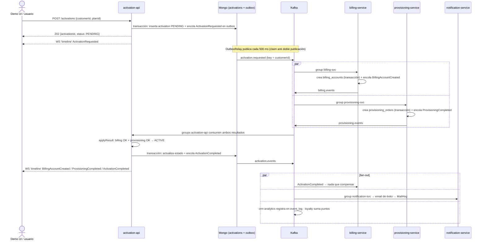
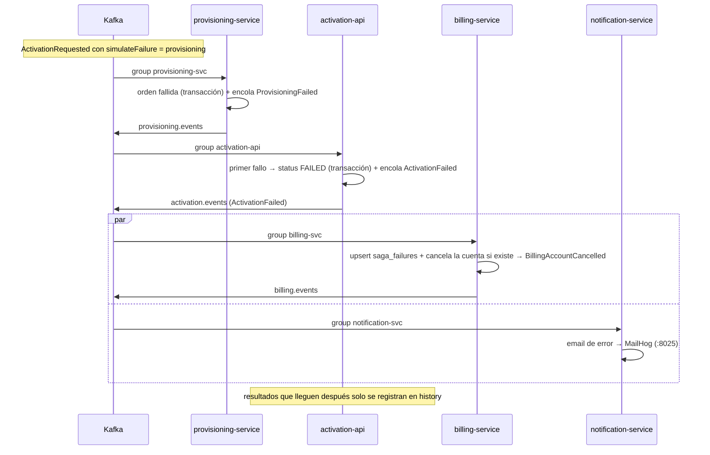
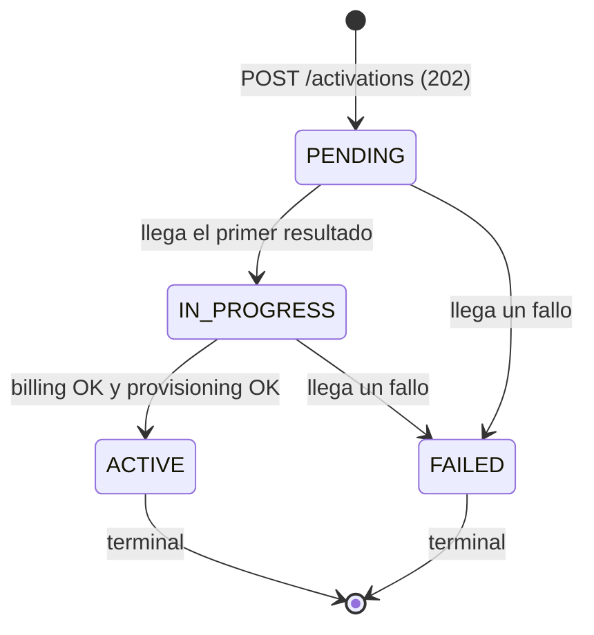

# Arquitectura — POC: Activación de Servicios con Kafka

Materia: Sistemas Distribuidos 2026 · Monorepo `activation-poc` (npm workspaces)

---

## 1. Objetivo y alcance

Esta POC modela la **activación de un plan de telecomunicaciones** como una **saga distribuida coreografiada sobre Apache Kafka**: al contratar un plan, dos pasos independientes (facturación y aprovisionamiento) deben completarse para que la activación quede `ACTIVE`; si alguno falla, el sistema **compensa** lo que ya se hizo y la activación queda `FAILED`.

Alcance de la demo:

- **6 servicios NestJS** (`activation-api`, `billing-service`, `provisioning-service`, `notification-service`, `crm-analytics-service`, `loyalty-service`) + **1 UI React/Vite** (`demo-ui`) con timeline en tiempo real por WebSocket (socket.io).
- **Garantías de mensajería** implementadas a mano sobre Kafka: idempotencia de consumidores, reintentos con backoff y DLQ, outbox transaccional, commit manual de offsets, orden por cliente vía clave `customerId`.
- **Observabilidad de la demo**: Kafka UI (consumers, lag, mensajes, DLQ), MailHog (emails), endpoints de consulta por servicio y endpoints `/dev/*` para probar DLQ e idempotencia.

Fuera de alcance: seguridad/auth, multi-broker/HA real, Schema Registry, exactamente-una-vez end-to-end (se garantiza *al-menos-una-vez + efectos idempotentes*).

---

## 2. Arquitectura

### 2.1 Componentes

```
                     ┌──────────────────────────────────────────────┐
                     │ demo-ui (React + Vite, :5173, nginx/dist)    │
                     │  REST ──────────────┐   socket.io 'timeline' │
                     └─────────────────────┼────────────────────────┘
                                           │
                    ┌──────────────────────▼───────────────────────┐
                    │ activation-api (:3000)  ← AGREGADOR de saga  │
                    │  POST/GET /activations · /dev/poison · /dev/replay
                    │  outbox ──► activation.requested             │
                    │  consume billing.events + provisioning.events│
                    │  estado: PENDING→IN_PROGRESS→ACTIVE|FAILED   │
                    └───────┬──────────────────────────▲───────────┘
                            │ activation.requested     │ billing.events /
                            │ (key = customerId)       │ provisioning.events
              ┌─────────────┴───────────┐   ┌──────────┴──────────────┐
              │ billing-service          │   │ provisioning-service    │
              │  billing_accounts        │   │  provisioning_orders    │
              │  saga_failures           │   │  saga_failures          │
              │  outbox ──► billing.events│   │  outbox ──► provisioning.events
              └─────────────▲───────────┘   └─────────────────────────┘
                            │ consume también activation.events (compensación)
        ┌───────────────────┴──────────────────────────────────────────┐
        │ activation.events (key = customerId) — fan-out a 4 grupos:   │
        │   billing-svc · notification-svc · crm-analytics · loyalty-svc│
        └───────┬───────────────────┬───────────────────┬──────────────┘
                │                   │                   │
      ┌─────────▼────────┐ ┌────────▼─────────┐ ┌───────▼──────────────┐
      │ notification-svc │ │ crm-analytics    │ │ loyalty-service      │
      │ email → MailHog  │ │ event_log, stats │ │ loyalty_points       │
      │ (SMTP :1025)     │ │ replay/earliest  │ │ (perfil `loyalty`)   │
      └──────────────────┘ └──────────────────┘ └──────────────────────┘

  Infraestructura (docker/): kafka (KRaft, 1 broker) · kafka-init (create-topics.sh)
  kafka-ui (kafbat :8080) · mongo (replica set rs0 :27017) · mongo-init (rs.initiate)
  mailhog (UI :8025 / SMTP :1025)
```

Cada servicio tiene **su propia base MongoDB** (`activation_api`, `billing`, `provisioning`, `notification`, `crm_analytics`, `loyalty`); lo único que comparten es el broker de Kafka.

### 2.2 Diagrama de secuencia — camino feliz



### 2.3 Diagrama de secuencia — fallo y compensación



---

## 3. Stack tecnológico y por qué

| Capa | Tecnología | Por qué |
|---|---|---|
| Runtime / lenguaje | Node.js 22 + TypeScript 5.8 | Un solo lenguaje en API, UI y libs compartidas; tipado del contrato de eventos. |
| Framework de servicios | **NestJS 11** + `@nestjs/microservices` | `@EventPattern` + `KafkaContext` dan el consumo declarativo; inyección de dependencias para armar el toolkit por módulo. |
| Cliente Kafka (consumo) | `@nestjs/microservices` (kafkajs por debajo) | Integración nativa con Nest: consumer groups, `fromBeginning`, `postfixId: ''` para nombrar los grupos como el documento. |
| Cliente Kafka (publicación) | **kafkajs propio en `libs/kafka-toolkit` (`EventPublisher`)** | `ClientKafka` de Nest no permite fijar la clave del mensaje; la clave `customerId` es requisito (ver Decisión #4). |
| Persistencia | **MongoDB con transacciones** (replica set `rs0` de 1 nodo) | Idempotencia y outbox necesitan transacción multi-índice en la *misma* base del servicio. |
| Consistencia de eventos | **Outbox transaccional** (`OutboxRelay`) | Evita el patrón *dual write* (DB + broker): el evento se guarda con el estado que lo origina. |
| UI | React 18 + Vite + socket.io-client | Timeline en vivo desde el gateway socket.io de `activation-api`. |
| Email | nodemailer → **MailHog** (SMTP 1025) | Contenedor de desarrollo: captura los emails sin enviar de verdad. |
| Infra local | **Docker Compose** |Levanta broker, Mongo replica set, UIs y los 6 servicios de una vez y permite escalar (`--scale`) y detener servicios sueltos. |
| Observabilidad | **Kafka UI (kafbat)** | Muestra consumidores, lag, offsets, mensajes y DLQ sin CLI. |
| Monorepo | npm workspaces (`apps/*`, `libs/*`) | `@poc/contracts` y `@poc/kafka-toolkit` compartidos sin publicar paquetes. |

---

## 4. Requerimientos funcionales y no funcionales

### 4.1 Requerimientos funcionales

| ID | Requerimiento | Dónde está implementado |
|---|---|---|
| RF-01 | Registrar una solicitud de activación y responder asincrónicamente | `POST /activations` → 202 con `{activationId, status: PENDING}`: `apps/activation-api/src/activations/activations.controller.ts` (`create`), validación de `customerId`/`planId` |
| RF-02 | Crear la activación y su evento inicial **en la misma transacción** | `apps/activation-api/src/activations/activations.service.ts` → `create()` (transacción Mongo: `insertOne` en `activations` + `outbox.enqueue(activation.requested)`) |
| RF-03 | Listar activaciones recientes y ver el detalle con historial de eventos | `GET /activations` y `GET /activations/:id` → `activations.controller.ts`, `ActivationsService.list()` / `getById()` |
| RF-04 | Crear la cuenta de facturación (o fallar a pedido) y publicar el resultado | `apps/billing-service/src/billing.service.ts` → `onActivationRequested()` (`BillingAccountCreated`, `BillingFailed` si `simulateFailure=billing`, encolado vía outbox) |
| RF-05 | Crear la orden de aprovisionamiento (o fallar a pedido) y publicar el resultado | `apps/provisioning-service/src/provisioning.service.ts` (mismo patrón que billing: transacción + outbox → `provisioning.events`) |
| RF-06 | Agregar los resultados de ambos pasos y decidir el estado final | `ActivationsService.applyResult()`: `FAILED` ante el primer fallo; `ACTIVE` + `ActivationCompleted` solo si `billing OK && provisioning OK`; si ya está en estado final, los resultados posteriores **solo se agregan a `history`** |
| RF-07 | Compensar cuando la activación falla | `apps/billing-service/src/billing.service.ts` → `onActivationOutcome()`: upsert en `saga_failures`, cancela la cuenta y publica `BillingAccountCancelled`; caso borde en `onActivationRequested()` si `ActivationFailed` llegó primero |
| RF-08 | Ver la saga en tiempo real en la Demo UI | `apps/activation-api/src/activations/timeline.gateway.ts` (gateway socket.io, evento `timeline`) + `apps/demo-ui/src/socket.ts` y `App.tsx` |
| RF-09 | Notificar por email el resultado (éxito o error) | `apps/notification-service` (nodemailer) consumiendo `activation.events`; emails visibles en MailHog `http://localhost:8025` |
| RF-10 | Vistas de consulta por servicio para la demo | `GET /accounts` (billing), `GET /orders` (provisioning), `GET /notifications` (notification), `GET /event-log`, `GET /stats`, `POST /event-log/replay` (crm-analytics), `GET /points` (loyalty), `GET /health` en los 6 servicios |

### 4.2 Requerimientos no funcionales

| ID | Requerimiento | Dónde está implementado |
|---|---|---|
| RNF-01 | No perder eventos aunque el servicio se caiga entre guardar y publicar | Outbox transaccional: `libs/kafka-toolkit/src/outbox.ts` (`OutboxRelay.enqueue()` dentro de la transacción + `tick()` cada 500 ms); uso en `activations.service.ts` (`create`, `applyResult`), `billing.service.ts` y `provisioning.service.ts` |
| RNF-02 | Orden de eventos **por cliente** | Clave del mensaje = `customerId` siempre: `libs/kafka-toolkit/src/publisher.ts` → `publish()` (`key: Buffer.from(event.customerId)`); tópicos de 3 particiones creados en `docker/create-topics.sh` |
| RNF-03 | Idempotencia de consumidores (efecto exactamente una vez por `eventId`) | `libs/kafka-toolkit/src/idempotency.ts` (`Idempotency.run`: inserta en `processed_events` con **índice único** y corre el efecto en la **misma transacción**); índice creado en `libs/kafka-toolkit/src/mongo.ts` → `ensureIndexes()` |
| RNF-04 | Un mensaje roto no bloquea la partición: reintentos y DLQ | `libs/kafka-toolkit/src/reliable.ts` (`ReliableConsumer`: valida el sobre, 3 intentos con espera 1 s/2 s/4 s, luego DLQ y commit); `publisher.ts` → `publishDlq()` con headers `x-original-topic`, `x-error`, `x-error-at`, `x-attempts` |
| RNF-05 | Retención y limpieza coherentes a 7 días | Retención 7 días de los topics en `docker/create-topics.sh`; TTL de 7 días sobre `processed_events.processedAt` en `mongo.ts` → `ensureIndexes()` |
| RNF-06 | Escalabilidad horizontal de consumidores y de los publicadores | Consumer groups sin sufijos (`postfixId: ''` en cada `main.ts`: `activation-api`, `billing-svc`, `provisioning-svc`, `notification-svc`, `crm-analytics`, `loyalty-svc`); 3 particiones por tópico; `docker compose up -d --scale billing-service=2`; claim de outbox con `claimedAt` vencido para multi-instancia (`outbox.ts`, `CLAIM_STALE_MS = 15000`) |
| RNF-07 | Evolución del contrato de eventos sin romper consumidores | Sobre con campo `version` por tipo de evento: `libs/contracts/src/events.ts` → `EVENT_VERSIONS`; validación de entrada en `libs/contracts/src/envelope.ts` → `parseEnvelope()` (rechaza sobre inválido → DLQ); `createEvent()` completa la versión actual |

---

## 5. Topics y contratos de eventos

### 5.1 Definición única de tópicos

`libs/contracts/src/topics.ts` es el único lugar donde se nombran (más `dlqTopic(topic)` que deriva la cola de errores):

```ts
export const TOPICS = {
  ACTIVATION_REQUESTED: 'activation.requested',
  BILLING_EVENTS:       'billing.events',
  PROVISIONING_EVENTS:  'provisioning.events',
  ACTIVATION_EVENTS:    'activation.events',
} as const;
```

Configuración común de los 4 tópicos (+ `<topic>.dlq`): **3 particiones, RF 1, retención 7 días, clave `customerId`** (creados por `kafka-init` al levantar el stack).

### 5.2 Matriz topic → eventos → productor → consumidores

| Topic | Eventos | Productor (grupo) | Consumidores (grupo) |
|---|---|---|---|
| `activation.requested` | `ActivationRequested` | activation-api (outbox, grupo `activation-api`) | billing-svc (`billing-svc`), provisioning-svc (`provisioning-svc`) |
| `billing.events` | `BillingAccountCreated`, `BillingFailed`, `BillingAccountCancelled` | billing-svc (outbox, grupo `billing-svc`) | activation-api (`activation-api`) |
| `provisioning.events` | `ProvisioningCompleted`, `ProvisioningFailed` | provisioning-svc (outbox, grupo `provisioning-svc`) | activation-api (`activation-api`) |
| `activation.events` | `ActivationCompleted`, `ActivationFailed` | activation-api (outbox, grupo `activation-api`) | billing-svc (compensación), notification-svc, crm-analytics, loyalty-svc |
| `<topic>.dlq` | mensaje original crudo + headers de error | `ReliableConsumer` vía `EventPublisher.publishDlq()` | — (solo inspección/replay manual desde Kafka UI) |

### 5.3 Ejemplo de sobre (`EventEnvelope`)

```json
{
  "eventId": "5f0c9f0e-7a1e-4a3f-9d21-0f5a6b7c8d9e",
  "eventType": "ActivationRequested",
  "version": 1,
  "occurredAt": "2026-11-11T14:03:12.481Z",
  "correlationId": "act-k3f91zqa",
  "customerId": "C-1234",
  "source": "activation-api",
  "payload": { "planId": "Plan Premium", "channel": "web", "simulateFailure": "none" }
}
```

### 5.4 Convenciones

- **Sobre uniforme** (`libs/contracts/src/envelope.ts`): el `payload` cambia por tipo de evento, el resto del sobre no.
- **Clave del mensaje**: siempre `customerId` (orden por cliente dentro de la partición).
- **`correlationId` = `activationId`**: agrupa todos los eventos de una misma activación (lo usa el agregador y la UI).
- **`source`**: nombre del servicio que publicó (visible en el timeline de la UI).
- **Headers del mensaje** (además del JSON): `eventId`, `eventType`, `correlationId`, `customerId`, `source`, `eventVersion` → permiten inspeccionar en Kafka UI sin abrir el valor.
- **Tipos de eventos** (`libs/contracts/src/events.ts`): `ActivationRequested`, `BillingAccountCreated`, `BillingFailed`, `BillingAccountCancelled`, `ProvisioningCompleted`, `ProvisioningFailed`, `ActivationCompleted`, `ActivationFailed`.
- **Payloads de resultado**: los fallos llevan `reason: string`; `ActivationFailed` lleva además `failedStep: 'billing' | 'provisioning'`.
- **Errores de negocio vs técnicos**: un fallo de negocio (`simulateFailure`) se publica como evento de resultado normal; solo los errores técnicos (sobre inválido o excepción persistente) van a la DLQ.

### 5.5 Versionado

- `EVENT_VERSIONS` asigna la versión actual de cada tipo (hoy todos `1`).
- `createEvent()` completa `version` automáticamente; los consumidores validan con `parseEnvelope()` que el sobre sea estructuralmente válido (no valida compatibilidad de versión todavía).
- Regla de evolución: cambios **aditivos** (campos nuevos opcionales) mantienen la versión; cambios **incompatibles** suben `version` y se actualizan consumidores antes de publicar el nuevo tipo. Un sobre sin `version` numérica es inválido → DLQ.

---

## 6. Flujos

### 6.1 Máquina de estados de una activación



Los estados son `PENDING | IN_PROGRESS | ACTIVE | FAILED` (`ActivationStatus` en `libs/contracts/src/events.ts`); los pasos individuales son `OK | FAILED` (`steps.billing`, `steps.provisioning` en el documento de `activations`).

### 6.2 Regla de agregación (`ActivationsService.applyResult`)

```
resultado de billing      → step billing    = OK (BillingAccountCreated) | FAILED (BillingFailed)
resultado de provisioning → step provisioning = OK (ProvisioningCompleted) | FAILED (ProvisioningFailed)

si status ya es ACTIVE o FAILED  → solo push a history (no se reabre la saga)
si el resultado es FAILED        → status = FAILED  + encola ActivationFailed (failedStep, reason)
si ambos steps están en OK       → status = ACTIVE  + encola ActivationCompleted
en otro caso                     → status = IN_PROGRESS (si venía de PENDING)
```

Todo ocurre dentro de **una transacción Mongo** (actualización del documento + enqueue en `outbox`), y recién después se emiten los `broadcast` al timeline por socket.io.

### 6.3 Caso borde de compensación (llega `ActivationFailed` antes de crear la cuenta)

1. `billing` procesa `ActivationFailed` en `onActivationOutcome()`: hace **upsert** en `saga_failures` con `correlationId`, `reason`, `failedStep`, `at` y, si la cuenta ya existe y no está cancelada, la cancela y publica `BillingAccountCancelled`.
2. Si `ActivationRequested` de esa misma activación llega **después** (replay, retraso), `onActivationRequested()` consulta `saga_failures` **dentro de la misma transacción**: al encontrar el fallo registrado, crea la cuenta **directamente en estado `CANCELLED`** (con `cancelReason: 'La activacion fallo antes de crear la cuenta'`) y publica `BillingAccountCancelled` en lugar de `BillingAccountCreated`.
3. La cuenta nunca queda “huérfana activa”: cualquier resultado posterior a un estado final solo se registra en `history`.

---

## 7. Modelo de datos MongoDB

Una **base por servicio**; cada base tiene además sus colecciones de soporte `outbox` y `processed_events` (creadas/indexadas por `connectMongo()` → `ensureIndexes()` en `libs/kafka-toolkit/src/mongo.ts`).

| Base | Colección | Contenido / campos clave | Índices |
|---|---|---|---|
| `activation_api` | `activations` | `_id` = activationId, `customerId`, `planId`, `status`, `simulateFailure`, `steps{billing,provisioning}`, `history[]` (eventType, at, source, payload), `createdAt`, `updatedAt` | `_id` (default) |
| `billing` | `billing_accounts` | `activationId`, `customerId`, `planId`, `status: CREATED \| CANCELLED`, `createdAt`, `cancelledAt?`, `cancelReason?` | `_id` (default) |
| `billing` / `provisioning` | `saga_failures` | `correlationId`, `reason`, `failedStep`, `at` (upsert; caso borde de compensación) | `_id` (default) |
| `provisioning` | `provisioning_orders` | orden simulada del aprovisionamiento (patrón análogo a `billing_accounts`) | `_id` (default) |
| `notification` | `notifications` | emails enviados (destinatario, asunto, tipo de evento, estado) | `_id` (default) |
| `crm_analytics` | `event_log` | proyección de `activation.events` para `/event-log` y `/stats` | `_id` (default) |
| `loyalty` | `loyalty_points`, `loyalty_awards` | saldo por cliente y premios otorgados | `_id` (default) |
| **todas** | `outbox` | `_id`, `topic`, `event` (sobre completo), `status: PENDING \| SENDING \| SENT`, `createdAt`, `claimedAt?`, `sentAt?`, `attempts` | `{ status: 1, createdAt: 1 }` |
| **todas** | `processed_events` | `eventId`, `processedAt` | `{ eventId: 1 }` **único** (idempotencia) · `{ processedAt: 1 }` **TTL 7 días** (`expireAfterSeconds: 604800`) |

El TTL de `processed_events` coincide con la retención de 7 días de los topics: pasado ese lapso un reenvío antiguo ya no sería detectado como duplicado, pero tampoco existe el mensaje original en el log.

---

## 8. Decisiones técnicas

### #1 Idempotencia de consumidores (efecto único por `eventId`)

`Idempotency.run(eventId, work)` inserta `{eventId, processedAt}` en `processed_events` (índice **único**) y ejecuta el efecto del consumidor **en la misma transacción Mongo**:

- evento repetido → el `insertOne` falla con duplicado (E11000) → se descarta como `'skipped'`;
- el efecto falla → la transacción se revierte → el reintento puede volver a intentarlo;
- el offset se confirma **recién después** de cerrar la transacción.

Esto hace seguro el *at-least-once* de Kafka y los reenvíos de `/dev/replay`, y también los duplicados del outbox (si el relay se cae después de publicar y antes de marcar `SENT`).

### #2 Reintentos con backoff y DLQ

`ReliableConsumer.handle()` valida el sobre con `parseEnvelope()`:

- **sobre inválido** → va directo a la DLQ y se confirma el offset;
- **error de procesamiento** → 3 intentos con espera exponencial **1 s, 2 s, 4 s** (`baseDelayMs * 2 ** (attempt-1)`);
- **agotó intentos** → `<topic>.dlq` con el mensaje original y los headers `x-original-topic`, `x-error` (truncado a 1000 chars), `x-error-at`, `x-attempts`;
- la publicación a la DLQ se reintenta 3 veces (250 ms) y, si igual falla, **se confirma igual el offset**: prevalece no bloquear la partición;
- el método **nunca lanza excepciones** (los controladores tienen una red de seguridad extra para no romper el bucle de kafkajs).

Los fallos de **negocio** (`simulateFailure=billing|provisioning`) no son técnicos: se publican como `BillingFailed`/`ProvisioningFailed` y no tocan la DLQ.

### #3 Outbox transaccional

El evento se guarda en la colección `outbox` **en la misma transacción** que el cambio de estado que lo origina (crear activación, aplicar resultado, crear cuenta/orden, compensar). `OutboxRelay`:

- `start(intervalMs = 500)`: publica pendientes cada 500 ms ordenando por `createdAt`;
- `findOneAndUpdate` con **claim** (`status: PENDING` o `SENDING` vencido a los 15 s) → dos instancias del mismo servicio nunca publican el mismo evento;
- procesa hasta 25 documentos por tick; si la publicación falla, devuelve el documento a `PENDING` y reintenta en el próximo tick;
- los consumidores son idempotentes, así que un eventual duplicado no tiene efectos.

Implementado en `activation-api`, `billing-service` y `provisioning-service` (los servicios que publican eventos de resultado).

### #4 Cliente Kafka aislado para publicar (no `ClientKafka`)

`EventPublisher` (`libs/kafka-toolkit/src/publisher.ts`) usa un productor **kafkajs propio**, aislado en la lib, porque:

- `ClientKafka` de `@nestjs/microservices` **no permite fijar la clave del mensaje**, y la clave `customerId` es requisito (RNF-02: orden por cliente);
- `acks: -1`, `idempotent: true`, `allowAutoTopicCreation: false` (los topics los crea `kafka-init`) y `retry: { retries: 8 }`;
- es el **único punto de salida** hacia Kafka: reemplazarlo (por el cliente oficial de Confluent) no toca ningún servicio.

Los servicios consumen con el transporte Kafka de Nest (`@EventPattern` + `KafkaContext`) y publican con este cliente.

### #5 Commit manual de offset

`ReliableConsumer` confirma el offset **después** de procesar (o de enviar a la DLQ), con `commitOffsets([{topic, partition, offset: actual + 1}])`. Nunca antes: si el proceso muere a mitad, el mensaje se reprocesa y la idempotencia evita efectos dobles. Si el commit falla, se loguea y el mensaje se reprocesará en el próximo arranque. Esto es lo que permite el escenario de “servicio caído” sin perder ni duplicar mensajes.

### #6 Coreografía con agregador

La saga es **coreografiada** (cada servicio reacciona a eventos y publica su resultado; nadie llama a otro por RPC) pero con un **agregador**: `activation-api` solo guarda estado y junta resultados (`ActivationsService` “nunca llama a otro servicio”). El agregador decide `ACTIVE`/`FAILED` y publica `ActivationCompleted`/`ActivationFailed` en `activation.events`, que es donde el resto del sistema reacciona (compensación, notificación, analítica, fidelización). `correlationId` = activationId mantiene todo correlacionado.

### #7 Mongo en replica set

Las transacciones de Mongo exigen un replica set, aunque sea **de 1 nodo**: `docker/mongo` arranca como `rs0` y `mongo-init` ejecuta `rs.initiate`. El URI por defecto de cada servicio es `mongodb://localhost:27017/?replicaSet=rs0&directConnection=true`. Además, **una base por servicio** evita acoplamiento en el esquema: solo se comparte el broker.

---

## 9. Estructura del repo y entorno local

### 9.1 Árbol

```
POC-Activaci-n-de-Servicios-con-Kafka/
├── package.json                  # npm workspaces: apps/*, libs/*
├── tsconfig.base.json            # config TS compartida
├── apps/
│   ├── activation-api/           # API REST + agregador + outbox + gateway socket.io
│   │   └── src/
│   │       ├── main.ts           # microservicio Kafka, grupo activation-api, outbox.start()
│   │       ├── app.module.ts     # Mongo, EventPublisher, Idempotency, OutboxRelay, ReliableConsumer
│   │       ├── health.controller.ts
│   │       └── activations/
│   │           ├── activations.controller.ts   # POST/GET /activations, /dev/poison, /dev/replay
│   │           ├── activations.service.ts      # saga: create() y applyResult()
│   │           ├── kafka-results.controller.ts # @EventPattern billing.events / provisioning.events
│   │           └── timeline.gateway.ts         # WebSocket socket.io 'timeline'
│   ├── billing-service/          # src/ (service, controller, app.module, main, health)
│   ├── provisioning-service/     # patrón billing: crea órdenes y publica provisioning.events
│   ├── notification-service/     # consume activation.events → email (nodemailer) a MailHog
│   ├── crm-analytics-service/    # event_log, stats, replay con grupo nuevo (earliest)
│   ├── loyalty-service/          # perfil `loyalty`; puntos desde activation.events (earliest)
│   └── demo-ui/                  # React + Vite (src/App.tsx, api.ts, socket.ts, types.ts)
├── libs/
│   ├── contracts/src/            # topics.ts · envelope.ts · events.ts · index.ts
│   └── kafka-toolkit/src/        # idempotency.ts · reliable.ts · outbox.ts · publisher.ts · mongo.ts
├── docker/                       # docker-compose.yml, create-topics.sh (kafka-init), mongo-init (rs.initiate), nginx (demo-ui)
└── docs/
    ├── architecture.md           # este documento
    └── demo-script.md            # guion de demo de 15 minutos
```

### 9.2 Entorno local (Docker Compose)

| Servicio | Rol | Puertos / URLs |
|---|---|---|
| `kafka` | apache/kafka en modo **KRaft**, 1 broker | `localhost:9092` (EXTERNAL) · `kafka:29092` (INTERNAL, para los servicios) |
| `kafka-init` | ejecuta `create-topics.sh`: crea los 4 topics + sus `.dlq` (3 particiones, RF 1, retención 7 d) | — |
| `kafka-ui` | kafbat — consumidores, lag, mensajes, DLQ | <http://localhost:8080> |
| `mongo` | MongoDB **replica set `rs0`** (1 nodo) | `localhost:27017` |
| `mongo-init` | `rs.initiate` (habilita transacciones) | — |
| `mailhog` | SMTP de desarrollo + bandeja web | UI <http://localhost:8025> · SMTP `localhost:1025` |
| `activation-api` | API REST + agregador + WebSocket | `http://localhost:3000` |
| `billing-service`, `provisioning-service`, `notification-service`, `crm-analytics-service` | consumidores/productores NestJS | puertos publicados por compose (ver `docker compose ps`) |
| `loyalty-service` | consumidor de `activation.events` (grupo nuevo) | bajo **profile `loyalty`** |
| `demo-ui` | nginx sirviendo `dist/` de Vite | <http://localhost:5173> |

Consumer groups (sin sufijos, `postfixId: ''`): `activation-api`, `billing-svc`, `provisioning-svc`, `notification-svc`, `crm-analytics`, `loyalty-svc`. `crm-analytics` y `loyalty-svc` arrancan con `fromBeginning: true`.

---

## 10. Criterios de aceptación y riesgos

### 10.1 Criterios y cómo verificarlos

| # | Criterio | Verificación |
|---|---|---|
| CA-1 | `POST /activations` responde 202 con `activationId` y la activación queda `PENDING` | `curl -s -X POST http://localhost:3000/activations -H "Content-Type: application/json" -d '{"customerId":"C-1","planId":"Plan Premium"}'` y luego `curl -s http://localhost:3000/activations/<id>` |
| CA-2 | Camino feliz: ambos pasos OK → `ACTIVE` + `ActivationCompleted` | Crear una activación sin fallo en la Demo UI y ver el timeline de 4 eventos (`ActivationRequested`, `BillingAccountCreated`, `ProvisioningCompleted`, `ActivationCompleted`) |
| CA-3 | Fallo → `FAILED` + `ActivationFailed` + compensación `BillingAccountCancelled` | UI con “Forzar fallo: En provisioning”; verificar `GET /accounts` de billing (la cuenta aparece `CANCELLED`) o la colección `billing.billing_accounts` en Mongo |
| CA-4 | El primer fallo define el estado y los resultados posteriores solo se agregan al historial | `GET /activations/<id>`: `status: FAILED`, `history` con los eventos posteriores y `steps` con el paso fallido |
| CA-5 | Idempotencia: un `eventId` repetido no duplica efectos | Copiar un sobre de Kafka UI y `curl -X POST http://localhost:3000/dev/replay -H "Content-Type: application/json" -d '{"topic":"billing.events","event":{...}}'` → no se crean cuentas/órdenes/emails extra; log `evento repetido ... ignorado (idempotencia)` |
| CA-6 | Un sobre inválido termina en la DLQ sin bloquear la partición | `curl -X POST http://localhost:3000/dev/poison` → aparece en `activation.requested.dlq` (Kafka UI) con headers `x-original-topic` y `x-error`; el consumo sigue normal |
| CA-7 | Commit manual: un consumidor caído no pierde mensajes | `docker compose stop notification-service`, crear activaciones, ver lag creciente en Kafka UI y luego `docker compose start notification-service` → llegan todos los emails |
| CA-8 | Escalabilidad: más instancias reparten las particiones | `docker compose up -d --scale billing-service=2` → Kafka UI muestra 2 consumidores en el grupo `billing-svc` sobre 3 particiones |
| CA-9 | Un consumidor nuevo puede relear el historial sin tocar a los demás | `docker compose --profile loyalty up -d loyalty-service` → grupo `loyalty-svc` con offset `earliest`; `GET /points` muestra datos históricos |
| CA-10 | Salud de todos los servicios | `curl -s http://localhost:3000/health` y `GET /health` de cada servicio (o `docker compose ps` en verde) |

### 10.2 Riesgos y mitigaciones

| Riesgo | Mitigación |
|---|---|
| Duplicados por reintentos, outbox o replays | Idempotencia transaccional con `processed_events` (índice único) — RNF-03 |
| Mensaje malformado bloquea una partición para siempre | Validación temprana + DLQ con headers de contexto y commit del offset — RNF-04 |
| Dual write (estado en Mongo, evento en Kafka) pierde eventos | Outbox en la misma transacción + relay con claim — RNF-01 |
| Pérdida de offset por procesamiento incompleto | Commit manual **después** de procesar; reproceso + idempotencia |
| Reparto desparejo de claves entre particiones | Clave `customerId` fija en `EventPublisher`; verificado con las 3 particiones por tópico |
| Dos instancias del mismo servicio publican el mismo outbox | Claim `SENDING` con `claimedAt` vencido (15 s) y orden por `createdAt` |
| Contrato de evento roto por un cambio de estructura | Sobre versionado (`EVENT_VERSIONS`) + `parseEnvelope()`; cambios incompatibles suben versión |
| El relay publica y el servicio se cae antes de marcar `SENT` (duplicado) | Duplicado tolerado: los consumidores son idempotentes por `eventId` |
| Replica set de 1 nodo no es HA real | Aceptado en la POC: habilita transacciones; la HA exigiría ≥3 nodos |
| Retención (7 d) y TTL (7 d) desincronizados | Se mantienen iguales a propósito; si cambia uno, cambiar el otro (`create-topics.sh` / `mongo.ts`) |
| `docker compose up` tarda (build + kafka-init + rs.initiate) | Esperar `/health` de los servicios y el estado `GREEN` en Kafka UI antes de arrancar la demo |
